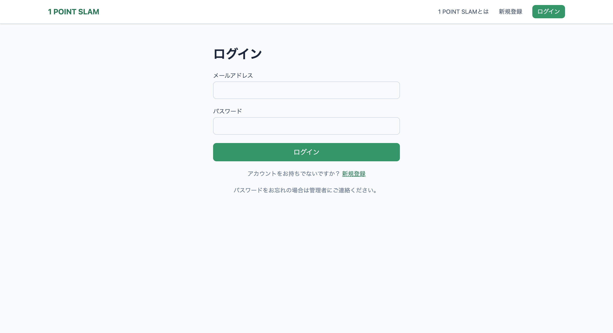
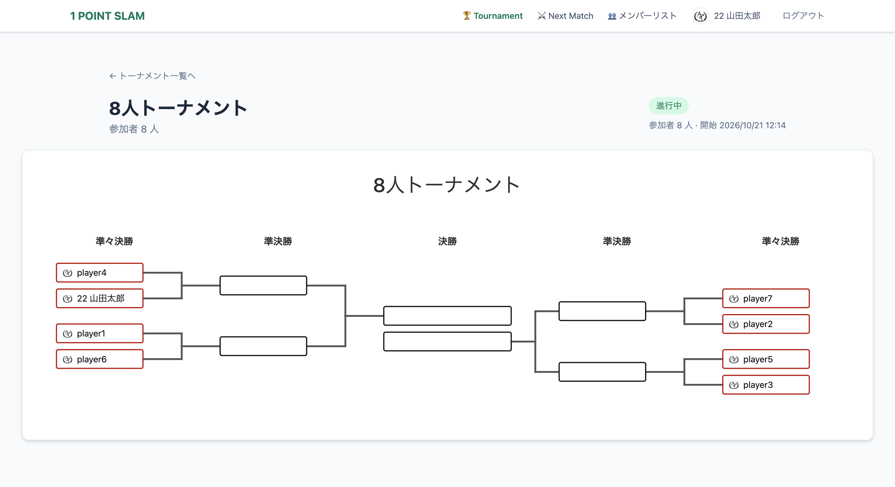
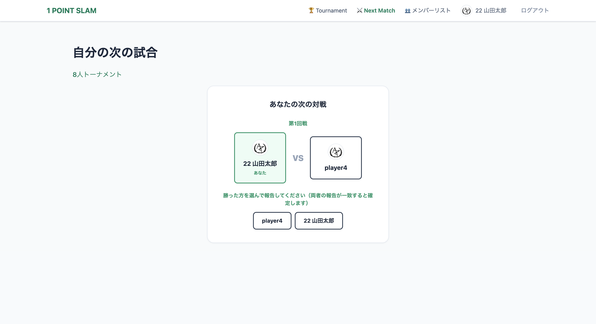

# テニスサークル大会運営システム

## 概要
テニスサークルの大会運営を自動化するWebアプリ。
参加者が試合結果を報告すると次の対戦が自動で決まり、
運営が手動で組み合わせを管理する必要をなくした。
本戦80名・コンソレーション31名が参加した大会で実運用。

### ログイン画面

### トーナメント表
参加者の組み合わせと勝ち上がりを一覧で確認できる。

### 勝敗の報告画面
試合後に勝った方を選んで報告する。両者の報告が一致すると勝敗が確定し、次の対戦が決まる。

## 開発背景
運営が本戦の対応に追われ、コンソレーションが毎年
途中で終わっていた。運営の負担を増やさずに最後まで
進行できる状態を目指して個人開発。

## 使用技術
- 言語・FW：Ruby on Rails 8.1 / Hotwire（Turbo・Stimulus）/ Tailwind CSS
- DB：SQLite
- インフラ・ホスティング：Fly.io（コンテナ化にDocker）
- 開発期間：2026年9月（約2週間）／個人開発

## 主な機能
- トーナメント表の自動生成（不戦勝シードの処理を含む）
- 参加者による試合結果の報告と、次の対戦の自動決定
- 進行状況のリアルタイム表示（Turbo Streamsで画面を自動更新）
- 自分の試合を確認できるマイページ、プロフィール・アイコン設定

## 振り返りと改善点
運営の負担軽減は達成した一方、登録者は参加者の
4分の1にとどまった。原因は登録の手間とUIの
分かりにくさ。次版ではメールアドレス登録を廃止し、
利用の少なかった層に実際に操作してもらって
つまずく箇所を観察したうえで設計し直したい。
